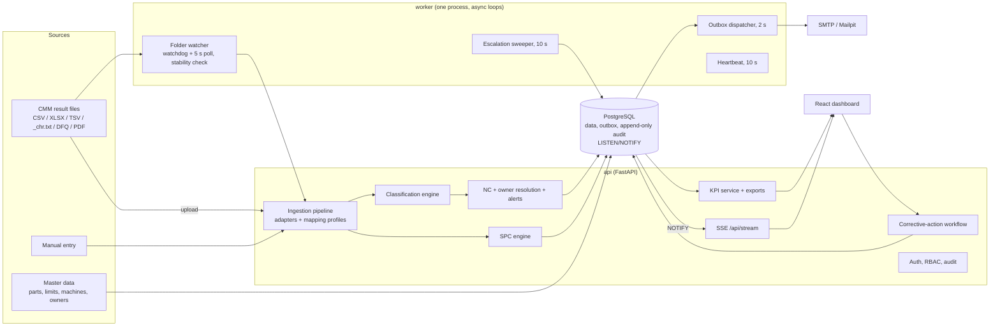

# Architecture

Smart CMM Quality is a vendor-neutral **action layer** on top of CMM software: it reads the
result files CMMs already write, decides OK / Marginal / Not OK, tells the right person, tracks the
fix to a verified close and measures every step. Source of truth: [`BUILD_SPEC.md`](BUILD_SPEC.md).
All data in this repository is synthetic.

## Components



| Service | Port | Notes |
|---|---|---|
| `db` | 5432 | PostgreSQL 17; Alembic migrations `0001` schema, `0002` audit trigger, `0003` indexes |
| `api` | 8000 | FastAPI, REST + SSE, OpenAPI at `/api/docs` |
| `worker` | – | folder watcher, escalation sweeper, outbox dispatcher, heartbeat |
| `web` | 5173 | Vite dev server (proxies `/api`); `web-prod` profile serves the build with Nginx on 8080 |
| `mailpit` | 1025 / 8025 | local SMTP catcher for the demo |

## Critical path: Not OK result to owner alert

```mermaid
sequenceDiagram
  participant CMM as CMM software
  participant FS as data/inbox/CMM-01
  participant WK as worker
  participant DB as PostgreSQL
  participant API as api (SSE hub)
  participant UI as Owner's browser
  participant SMTP as Mailpit
  CMM->>FS: writes DC101_SN0457_chr.txt (+ _hdr.txt)
  WK->>WK: size stable over 2 checks 1 s apart [received_at]
  WK->>DB: BEGIN: report + measurements + classification + SPC
  WK->>DB: NC + alert (generation_ms) + outbox email + audit; pg_notify; COMMIT
  DB-->>API: NOTIFY events {alert.created, recipient}
  API-->>UI: SSE alert.created -> toast + bell + sound
  WK->>DB: outbox FOR UPDATE SKIP LOCKED
  WK->>SMTP: send [outbox.sent_at]
  WK->>DB: escalation sweep: unacknowledged after 60 s / 120 s (demo) -> supervisor / Quality Head
```

**One transaction.** `ingest_parsed` flushes report, measurements, NC, alerts, the outbox row and
audit entries; the caller commits once. `pg_notify` runs inside the same transaction, so listeners
only hear about committed data (transactional outbox pattern, Section 6 D7).

## Backend layout (`backend/app`)

| Path | Responsibility |
|---|---|
| `core/` | settings, DB engine, JSON logging with request IDs, security (Argon2id, JWT cookie), LISTEN/NOTIFY hub, clock, health |
| `models/` | SQLAlchemy models for every table in Section 7 |
| `services/adapters/` | `generic_table` (CSV/TSV/XLSX), `manual`, `calypso_chr`, `aqdef`, `pdf_table`; never touch the DB |
| `services/ingestion/` | `pipeline` (one function for upload, folder and manual), `normalize`, `validate` |
| `services/classification.py` | pure Decimal tolerance engine (golden-tested) |
| `services/nonconformance.py`, `ownership.py`, `alerts.py`, `escalation.py`, `notifications/` | the alert loop |
| `services/capa.py` | NC state machine and corrective-action workflow |
| `services/spc.py` | I-MR limits, Nelson rules, capability gate |
| `services/kpi.py`, `exports.py` | K1–K6 and Excel/PDF |
| `services/audit.py` | append-only audit writer |
| `ai/` | optional, flag-gated: PDF extraction with confirmation, similar NCs, weekly summary |
| `worker/` | `main` (async loops), `folder_watcher` |
| `seed/` | demo masters, synthetic process model, 30-day history, storyline reset |

## Frontend layout (`frontend/src`)

`app/` router, layout, toasts · `api/` typed client, SSE hook (TanStack Query invalidation) ·
`components/` UI primitives, ECharts wrapper, filters · `features/` dashboard, reports, mapping,
ncs, alerts, spc, audit, settings, masters, auth.

## Data integrity and security

- `audit_log` is append-only: trigger `audit_log_append_only` rejects UPDATE and DELETE.
- Reports and measurements are never edited; corrections are re-inspections or NC cancellation.
- JWT in an httpOnly, SameSite=Strict cookie (12 h); Argon2id hashes; login rate limit.
- Server-side role checks on every write endpoint (Section 14.1); the UI only hides buttons.
- Uploads stored under `data/` with random names; size and extension checks; filenames sanitized.
- Secrets only in `.env` (gitignored); `.env.example` documents every key.

## Deployment

Prototype: `docker compose up` on one laptop. Plant: the same Compose stack on a small on-prem
server; each CMM PC exports to a shared folder mounted as `data/inbox/<CMM>`. No internet needed
(the optional AI module is the only component that calls an external API, and it is off by default).
