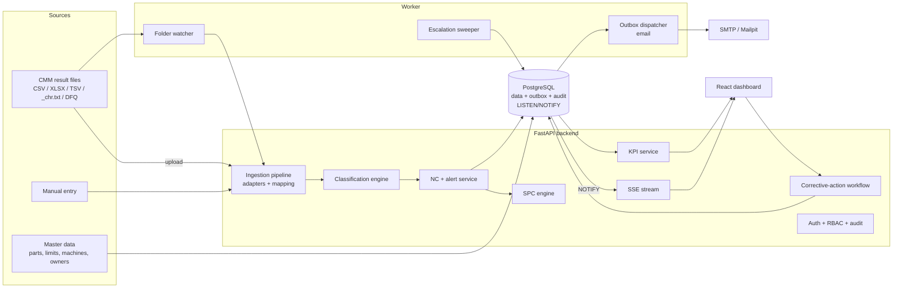
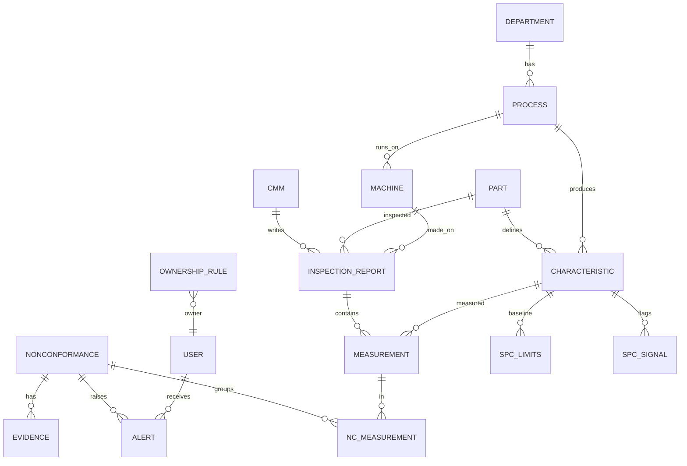
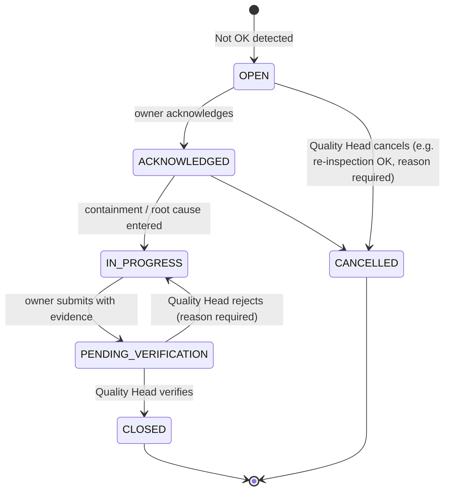

# Smart CMM Quality Alert and Action Tracking System
## Prototype Build Specification

| Field | Value |
|---|---|
| Event | Sakthi Hackathon 2.0, Round 2 (PPT + 5-minute demo video) |
| Team | Xyrus, Team ID SKH2-2026-00196, Chennai Institute of Technology |
| Problem statement | PS-011: Real-Time CMM Quality Dashboard with Automatic Non-Conformance Alerts (THEME-03, Quality 4.0, Metrology & Inspection Automation) |
| Members | Yaswanth K B (Leader), Shyam Kumar J, Suganth Renu K, Sam Joshua S |
| Spec version | 1.0, 05 Nov 2026 |
| Round 2 deadline | 24 Nov 2026, 11:00 PM (portal). Internal code freeze: 18 Nov 2026 |
| Repository | `smart-cmm-quality` (suggested name) |

---

## 0. How to use this document

**For the team.** This is the single source of truth. Read Sections 1 to 6 before writing code so everyone can explain *why* each choice was made. Judges at an industry hackathon ask "why this and not that", and Section 6 is the answer sheet.

**For Claude Code.** Save this file as `docs/BUILD_SPEC.md` in the repository and create `CLAUDE.md` at the repository root with the content in Section 24. Then build one phase at a time (Section 22). Claude Code must **not** run any git command that changes state. At the end of each commit unit it stops and prints the commit ID and message from Section 23, and a human runs the git commands.

**Words used in this spec.**
- **MUST**: required for the Round 2 demo.
- **SHOULD**: build if on schedule.
- **COULD**: only if everything else is done.
- **ASSUMPTION**: something we believe about the plant but have not confirmed with Sakthi. Assumptions are written down so we never present them as facts.

---

## 1. Context and non-negotiables

### 1.1 What we promised in Round 1 (judges have read this)

The Round 1 write-up was shortlisted. Round 2 must show the *same system working*. Nothing in the prototype, PPT or video may contradict these promises:

| # | Round 1 promise (verbatim meaning) | Where it is built | Phase |
|---|---|---|---|
| R1 | Upload: CMM report goes in as a file or through a watched folder | Ingestion pipeline, upload API, folder watcher | 4, 13 |
| R2 | A simple column-mapping screen reads any report layout | Mapping profiles + mapping editor UI | 4, 10 |
| R3 | Check: every size compared with its limits, marked OK, Marginal (close to limit) or Not OK | Classification engine | 5 |
| R4 | Alert: for a Not OK, the owner of that machine/process is told in seconds by app and email | NC service, in-app SSE alerts, email via outbox | 6 |
| R5 | If nobody responds, it goes to the next person up | Escalation sweeper | 6 |
| R6 | Fix: owner records cause, action, target date and proof | Corrective-action workflow, evidence upload | 7 |
| R7 | The quality head verifies it and closes it | Verification step, role-based permissions | 7 |
| R8 | See: one dashboard shows parts inspected, OK and Not OK counts, open and closed actions, trends by date, part and machine | KPI service + dashboard | 8, 9 |
| R9 | Closing time is measured automatically | Closure lead-time KPI | 8 |
| R10 | OK%, Not OK% and trends are worked out automatically, nobody builds reports by hand | KPI service, Excel export | 8, 14 |
| R11 | SPC drift rules warn before a part fails | SPC engine + control chart | 12 |
| R12 | Role-based access and full audit trail | RBAC, append-only audit log | 2, 1 |
| R13 | Software only, no hardware | Whole system | all |
| R14 | Works fully without AI; optional AI reads messy PDFs and suggests fixes that worked before | Feature-flagged AI module | 15 |

### 1.2 PS-011 deliverables (this is the judging rubric)

The problem statement lists six technical requirements and six expected deliverables. Every one maps to a feature and a KPI, and the demo video must point at each.

| PS-011 item | Feature | KPI ID (Section 13) |
|---|---|---|
| Integrate / import CMM result data | Adapters + mapping profiles + watched folder | K-INGEST |
| Automatic result classification | Classification engine | K1, K2 |
| Immediate alerts to concerned process/department | Ownership rules + alerts + escalation | K3 |
| Configurable filters | Dashboard filters (date, part, machine, process, shift) | all |
| Action-owner and closure status | NC + corrective-action workflow | K4, K5 |
| Historical trend and report export | Trends, Pareto, Excel/PDF export | K6 |
| Real-time display of total CMM inspected, OK and Not OK quantities | Live dashboard tiles | K1 |
| Automatic calculation of OK% and Not OK% | KPI service | K2 |
| Alert generation time for every Not OK result | Timestamps on every alert | K3 |
| Open, pending and closed corrective actions quantified | NC status buckets | K4 |
| Corrective-action closure lead time | Lead-time KPI | K5 |
| Date-, part- and machine/process-wise trends without manual consolidation | Trend endpoints + charts | K6 |

### 1.3 Honesty rules (what we will NOT claim)

1. **No live connection to a CMM controller.** We read the result files CMM software already writes. "Real-time" means *seconds after the CMM software writes its report*. We will say "near-real-time, file-triggered" if asked.
2. **No real Sakthi data.** All data is synthetic and labelled as such on screen ("Demo data").
3. **No certification claims.** We say "aligned with" ISA-18.2 alarm principles, ISO 14253-1 decision-rule ideas and IATF 16949 corrective-action practice, never "compliant with".
4. **No AI accuracy numbers on synthetic data.**
5. **Demo escalation timers are shortened** (seconds instead of minutes), and the video says so.
6. **Vendor file formats are implemented from public documentation and sample structure**, not vendor certification. Each adapter states this in its docstring.

---

## 2. The problem in plant terms

### 2.1 Who uses the system (personas)

| Persona | Role in the loop | What they need |
|---|---|---|
| CMM Inspector | Runs the CMM program, owns the result | Drop or upload the report, see the verdict, re-measure marginal parts |
| Process Owner | Owns the machine or operation that made the part (e.g. finish boring on VMC-02) | Be told immediately, know exactly which characteristic failed and by how much, record the fix |
| Shift Supervisor | Responsible for the area during the shift | Be told only when the owner does not respond (escalation) |
| Quality Head | Approves corrective actions | Verify, reject or close; see the plant-wide picture and overdue actions |
| Plant Management | Reviews performance | Trends, Pareto of problems, closure performance |
| Admin | Configures masters and formats | Parts, characteristics, machines, owners, mapping profiles, settings |

### 2.2 Today's process (ASSUMPTION, to validate with Sakthi)

1. The CMM runs a program and writes a report (PDF/printout, and sometimes a table file).
2. The inspector reads it and tells the production team by phone, WhatsApp or in person.
3. At shift end or weekly, someone consolidates results into Excel.
4. Corrective actions are tracked on paper or in sheets.

**Consequences:** late containment (more bad parts made while the alert is delayed), no single view of OK/Not OK, unclear ownership, no measured closure time, trends hidden in files.

### 2.3 The core insight we are building around

The value is not the dashboard. The value is the **closed loop**: measurement → verdict → the right person told → acknowledged → fixed → verified → closed, with every step time-stamped. The dashboard is the *result* of the loop, not the product.

### 2.4 Business case (formulas only, no invented numbers)

We do not have plant numbers, so we present formulas and fill them with Sakthi's baseline later.

- **Bad parts avoided per Not OK event** ≈ machine output rate (parts/hour) × reduction in detection delay (hours).
- **Quality-team hours saved per week** = hours spent consolidating reports today − hours spent after automation.
- **Closure performance** = median closure lead time before vs after, and % actions closed by target date.

The prototype measures detection delay (`received_at − measured_at`) and alert time directly, so these numbers become real the moment real files flow in.

---

## 3. Market landscape and positioning

### 3.1 What already exists

- **CMM software writes result files.** ZEISS CALYPSO can write "table files" (`_chr.txt` characteristics, `_fet.txt` features, `_hdr.txt` header), which are tab-delimited, into its `workarea/results` folder when the Table File option is enabled. Hexagon PC-DMIS can output reports to XLSX, XLS or CSV, and its Excel Form Report can also write tab-delimited TXT.
- **Automotive data exchange standard.** AQDEF (Q-DAS ASCII transfer format, `.dfq` files) uses numbered K-fields, for example K0001 measured value, K0004 time, K0010 machine number, K1001 part number, K2001 characteristic number, K2002 characteristic description.
- **Open XML standard.** QIF (Quality Information Framework) is an ANSI/DMSC standard (QIF 3.0, 2018) and ISO 23952:2020, with dedicated Results and Statistics models.
- **Commercial SPC and reporting suites** exist (for example ZEISS PiWeb, Q-DAS qs-STAT, PC-DMIS reporting, QC-Calc). They are statistics- and reporting-heavy and usually tied to a vendor ecosystem.

### 3.2 Our position (say this in Q&A)

> We do not replace the CMM software or the SPC suite. We are the **vendor-neutral action layer** on top of them. We read the files the CMMs already produce, so nothing changes at the CMM, and we close the loop from a Not OK result to a verified fix with a named owner and a measured time.

Why this is credible for a plant:
- Zero change to CMM programs (reads existing exports).
- Works with mixed CMM brands through mapping profiles.
- Runs on-premise on the plant network (quality data stays inside).
- Low cost to adopt: open-source stack, one Docker Compose deployment.

---

## 4. Scope (MoSCoW)

| Priority | Feature |
|---|---|
| MUST | Generic CSV/XLSX ingestion with mapping profiles; manual entry fallback |
| MUST | Upload API with duplicate detection and validation |
| MUST | Classification OK / Marginal / Not OK with guard band |
| MUST | Non-conformance (NC) creation and owner resolution |
| MUST | In-app real-time alerts (SSE) and email alerts (Mailpit in demo) |
| MUST | Escalation to supervisor and quality head |
| MUST | Corrective-action workflow with evidence and verification |
| MUST | KPI dashboard covering all six PS-011 deliverables, with filters |
| MUST | RBAC and append-only audit log |
| MUST | Synthetic data generator and demo storyline seed |
| SHOULD | SPC: I-MR control chart, Nelson rules, Cp/Cpk/Pp/Ppk |
| SHOULD | Watched-folder ingestion with file-stability check |
| SHOULD | CALYPSO-style `_chr.txt` adapter and AQDEF subset adapter |
| SHOULD | Excel export; PDF report summary |
| SHOULD | Mapping profile editor UI with live preview |
| COULD | Optional AI: PDF extraction with human confirmation, similar-past-NC suggestions, weekly summary |
| COULD | Uncertainty-aware decision rule (ISO 14253-1 style) per characteristic |
| WON'T (prototype) | Direct CMM controller/DMIS integration, ERP/MES integration, WhatsApp, mobile app, multi-plant tenancy |

**Cut line.** If behind schedule on 15 Nov, drop COULD items first, then PDF export, then the AQDEF adapter. Never cut anything in the MUST row.

---

## 5. System architecture

### 5.1 Component view



### 5.2 Processes (containers)

| Service | Purpose | Port (dev) |
|---|---|---|
| `db` | PostgreSQL | 5432 |
| `api` | FastAPI app (REST + SSE) | 8000 |
| `worker` | Folder watcher, escalation sweeper, outbox dispatcher, SPC recompute | none |
| `web` | React app (Vite dev server; Nginx in production build) | 5173 / 8080 |
| `mailpit` | Local SMTP catcher with web UI for the demo | 1025 (SMTP), 8025 (UI) |

### 5.3 The critical path: Not OK result to owner alert

```mermaid
sequenceDiagram
  participant CMM as CMM software
  participant FS as Watched folder
  participant WK as Worker
  participant API as API (ingestion)
  participant DB as PostgreSQL
  participant UI as Owner's browser
  participant SMTP as Mailpit

  CMM->>FS: writes DC101_SN0457_chr.txt
  WK->>WK: wait until file size is stable
  WK->>API: ingest(file)  [received_at]
  API->>API: sha256 dedupe, detect format, parse, normalize, validate
  API->>DB: BEGIN; insert report + measurements
  API->>API: classify each characteristic
  API->>DB: insert NC, alert rows, outbox email; COMMIT  [alert.created_at]
  DB-->>API: NOTIFY 'events'
  API-->>UI: SSE alert.created (bell + toast)
  WK->>DB: poll outbox (SKIP LOCKED)
  WK->>SMTP: send email  [outbox.sent_at]
```

**Design rule:** report, measurements, NC, alerts and the outbox email row are written in **one transaction**. Either the whole result is recorded and alerted, or nothing is. This is the transactional outbox pattern.

### 5.4 Deployment model

- Prototype and demo: `docker compose up` on one laptop.
- Plant story: the same Compose stack on a small on-premise server on the plant LAN. Each CMM PC exports to a shared network folder that the worker watches. No internet required.

---

## 6. Technology choices and decision records ("why this, not that")

Pin exact versions in lockfiles at build time (`uv.lock`, `package-lock.json`). Use the latest stable releases available when Phase 0 starts.

| # | Decision | Chosen | Alternatives considered | Why we chose it | Trade-off we accept |
|---|---|---|---|---|---|
| D1 | Backend language/framework | Python 3.12 + FastAPI | Node/Express, Spring Boot | SPC and parsing need numpy/pandas; Pydantic gives typed validation; automatic OpenAPI docs help judges and teammates; team has shipped FastAPI before | Slower than Go/Java, irrelevant at plant volumes (thousands of reports/day) |
| D2 | Database | PostgreSQL | MongoDB, SQLite | Strong relations (part → characteristic → measurement → NC), multi-row transactions for atomic ingest, window functions for KPIs, LISTEN/NOTIFY for live events, triggers for append-only audit | Schema migrations needed (Alembic) |
| D3 | Time-series store | Plain Postgres with indexes | InfluxDB, TimescaleDB | Data volume is small; one database is simpler to run and back up. TimescaleDB is a Postgres extension and can be added later without app changes | None at prototype scale |
| D4 | Live updates to browser | Server-Sent Events (SSE) | WebSocket, polling | Traffic is one-way (server → browser); SSE runs over plain HTTP, reconnects automatically, works through proxies | No client → server messages over the stream (not needed; we use REST) |
| D5 | Event fan-out between processes | Postgres LISTEN/NOTIFY | Redis pub/sub, Kafka | No extra service; events originate from the same DB transaction | NOTIFY payload limit (send IDs, not full objects) |
| D6 | Background jobs | One `worker` process with async loops | Celery + Redis, APScheduler cluster | Three small periodic jobs do not justify a broker; fewer moving parts in a plant | Horizontal scaling of jobs needs `SKIP LOCKED` (already used) |
| D7 | Email reliability | Transactional outbox table + dispatcher with retries | Send email inside the upload request | Upload never blocks on SMTP; an email is never lost if SMTP is down; retries are visible | Email arrives a few seconds after in-app alert (measured separately) |
| D8 | Frontend | React + TypeScript + Vite SPA | Next.js | Internal tool on a LAN behind login: no SEO or SSR need; static build served by Nginx; team knows React | No server rendering (not needed) |
| D9 | UI kit and data fetching | Tailwind CSS + shadcn/ui + TanStack Query | MUI, Redux | Fast consistent UI; TanStack Query caching + invalidation on SSE events keeps the dashboard live with little code | — |
| D10 | Charts | Apache ECharts | Recharts, Chart.js | Control charts need UCL/LCL/spec bands (markLine/markArea), thousands of points, zoom | Larger bundle |
| D11 | Ingestion design | Canonical schema + adapters + mapping profiles | One hard-coded parser per vendor | A new CMM layout becomes a configuration, not a code change; this is the core answer to "formats vary" | Mapping UI to build |
| D12 | Source of truth for limits | Master data (part, drawing revision) | Limits printed in the report | Drawing revision is controlled; if report limits differ from master, we flag a **limit mismatch** (a real drawing-revision risk) | Master data must be seeded |
| D13 | Number comparison | `Decimal` quantized to the characteristic's decimals | Float comparison | Avoids 72.030000001 > 72.030 errors at the limit | Slightly more code |
| D14 | Control chart type | Individuals and Moving Range (I-MR) | X̄-R / X̄-S | CMM inspects parts one at a time; rational subgroups are rare in low-volume sampling; I-MR is the standard chart for individual measurements | Less sensitive to small shifts than subgrouped charts |
| D15 | Out-of-control rules | Nelson rules 1, 2, 3, 5 on by default; 4, 6, 7, 8 configurable | All 8 always on | Each added rule raises the false-alarm rate; 1/2/3/5 catch outliers, shifts and tool-wear trends, which matter most in machining | Some patterns detected later |
| D16 | Control limits | Frozen from a baseline window; recalculated only by Quality Head (audited) | Rolling recalculation | Rolling limits follow the drift and hide it | Requires an explicit "set baseline" action |
| D17 | Capability gate | Show Cp/Cpk only with ≥ 30 readings and no active signals; else "insufficient data" / "process not stable" | Always show | Capability from tiny or unstable samples misleads; quality judges spot this instantly | Fewer numbers on early screens |
| D18 | Auth transport | JWT in httpOnly, SameSite=Strict cookie | Bearer header in localStorage | Browser `EventSource` cannot send custom headers, so SSE needs cookie auth; httpOnly blocks token theft by scripts | CSRF handled by SameSite=Strict + same-origin API |
| D19 | Password hashing | Argon2id | bcrypt | Current OWASP-recommended default | — |
| D20 | Deployment | On-prem Docker Compose | Cloud SaaS | Quality data confidentiality, no internet dependency, plant IT acceptance | Plant hosts a server |
| D21 | Alert channels | In-app + email | WhatsApp, SMS | Email is universal in plants and free; WhatsApp Business API needs approval and cost. A webhook channel is designed in for later | Email is not instant on phones without push |
| D22 | AI | Optional, feature-flagged, never in the alert path | AI-first classification | Tolerance checks are exact rules; AI there would be slower, less reliable and unexplainable. AI only helps with messy inputs and suggestions, with human confirmation | Less "AI wow", much more trust |
| D23 | Python tooling | `uv` + `ruff` + `pytest` (+ `hypothesis`) | pip + flake8 | Fast installs with a lockfile, one linter/formatter, property-based tests for boundary logic | Team learns `uv` (5 minutes) |
| D24 | PDF export | ReportLab | WeasyPrint | Pure Python, no system libraries in the Docker image | Less HTML-like layout |

---

## 7. Domain model and database schema

### 7.1 Entity overview



### 7.2 Tables (key columns)

All tables have `id` (UUID or bigserial), `created_at`, `updated_at` (UTC, `timestamptz`). Display in IST in the UI.

**Masters**

| Table | Columns |
|---|---|
| `departments` | name, head_user_id |
| `processes` | code (e.g. `OP-30`), name, department_id |
| `machines` | code (e.g. `VMC-02`), name, process_id, line, is_active |
| `cmms` | code (e.g. `CMM-01`), vendor (`ZEISS_CALYPSO`, `HEXAGON_PCDMIS`, `OTHER`), default_mapping_profile_id, inbox_path |
| `parts` | part_no, name, drawing_no, drawing_rev, is_active |
| `characteristics` | part_id, char_no, name, kind (`DIMENSION`, `GEOMETRIC`), tolerance_type (`BILATERAL`, `UPPER_ONLY`, `LOWER_ONLY`), nominal, usl, lsl (nullable for one-sided), unit (`mm`), decimals (default 3), classification (`CRITICAL`, `SIGNIFICANT`, `STANDARD`), process_id, guard_band_pct (nullable override), expanded_uncertainty (nullable), is_active. Unique (part_id, char_no) |
| `ownership_rules` | part_id?, process_id?, machine_id?, owner_user_id, supervisor_user_id, priority. **Most specific match wins** (machine > process > part > department head fallback) |
| `users` | email, full_name, role (`ADMIN`, `QUALITY_HEAD`, `SUPERVISOR`, `PROCESS_OWNER`, `INSPECTOR`, `VIEWER`), department_id, password_hash, is_active |
| `mapping_profiles` | name, vendor, file_kind (`CSV`, `XLSX`, `TSV`, `CALYPSO_CHR`, `AQDEF`, `PDF`), delimiter, decimal_separator, header_row, column_map (jsonb), header_fields (jsonb: where part no / serial / machine / measured_at come from: a column, a filename regex, or a header line), unit, is_active |
| `settings` | key, value (jsonb), updated_by. Keys: `guard_band_pct_default` (10), `escalation` (timers per classification), `spc_rules_enabled`, `recurrence_window_hours`, `ai_enabled` |

**Transactions**

| Table | Columns |
|---|---|
| `inspection_reports` | report_no, cmm_id, part_id, machine_id, process_id, serial_no, batch_no, operator_name, **measured_at** (from report), **received_at** (file arrival / upload start), **ingested_at** (committed), source (`UPLOAD`, `WATCH_FOLDER`, `MANUAL`, `AI_PDF`), original_filename, storage_path, **sha256 (unique)**, mapping_profile_id, part_result (`OK`, `MARGINAL`, `NOK`), nok_count, marginal_count, status (`INGESTED`, `NEEDS_CONFIRMATION`, `FAILED`), warnings (jsonb), uploaded_by, reinspection_of_report_id |
| `measurements` | report_id, characteristic_id, machine_id (denormalized for SPC), measured_at, actual, nominal/usl/lsl **snapshot**, deviation, tolerance_used_pct, result, is_suspect, limits_source (`MASTER`, `REPORT`). Index (characteristic_id, machine_id, measured_at) |
| `nonconformances` | nc_no (`NC-2026-00042`), part_id, machine_id, process_id, first_report_id, severity (from worst characteristic classification), status, owner_user_id, supervisor_user_id, detected_at, acknowledged_at, acknowledged_by, escalation_level (0/1/2), target_date, containment, root_cause_category (6M: Man, Machine, Method, Material, Measurement, Environment), root_cause, corrective_action, preventive_action, submitted_at, verified_by, verified_at, verification_note, closed_at, cancel_reason, recurrence_count |
| `nc_measurements` | nc_id, measurement_id |
| `alerts` | kind (`NOK`, `RECURRENCE`, `ESCALATION`, `SPC_WARNING`, `SYSTEM`), nc_id?, spc_signal_id?, level, recipient_user_id, title, body, **source_received_at**, created_at, read_at, acknowledged_at, **generation_ms** |
| `outbox` | kind (`EMAIL`), payload (jsonb), status (`PENDING`, `SENT`, `FAILED`), attempts, next_attempt_at, sent_at, last_error |
| `evidence` | nc_id, filename, storage_path, mime, size, sha256, note, uploaded_by |
| `spc_limits` | characteristic_id, machine_id, center, ucl, lcl, mr_bar, sigma_within, n_baseline, baseline_from, baseline_to, frozen_by, is_active |
| `spc_signals` | characteristic_id, machine_id, rule (`N1`, `N2`, `N3`, `N5`…), measurement_ids (jsonb), status (`ACTIVE`, `ACKNOWLEDGED`, `CLEARED`), triggered_at |
| `audit_log` | bigserial id, at, actor_user_id, actor_role, action, entity, entity_id, before (jsonb), after (jsonb), request_id, ip. **Append-only** (Section 16) |

### 7.3 Non-conformance state machine



Escalation level is a separate counter, not a state. Every transition writes an audit entry and a timeline event.

---

## 8. Ingestion and adapters

### 8.1 Pipeline (one function, used by upload, watched folder and manual entry)

1. **Receive.** Record `received_at`. Enforce size limit (20 MB) and extension whitelist (`.csv .xlsx .txt .tsv .dfq .pdf`).
2. **Dedupe.** SHA-256 of bytes. If it exists, return HTTP 409 with a link to the existing report. Re-uploads never double-count.
3. **Detect format.** Use the selected mapping profile, or sniff: K-field lines → AQDEF; tab-delimited file ending `_chr.txt` → CALYPSO-style; otherwise generic table.
4. **Parse** through the adapter into `RawRecord`s (header fields + one row per characteristic).
5. **Normalize.** Decimal comma → dot (German-locale exports); trim; units (inch → mm when the profile declares inches); timestamps to UTC.
6. **Resolve masters.** Part by part_no; characteristic by (part, char_no). Machine from report header, filename pattern, or the upload form.
7. **Validate.**
   - Missing required fields → report `FAILED` with readable errors (and moved to `failed/` if from folder).
   - Unknown characteristic → warning; row kept with report limits, `limits_source = REPORT`.
   - **Limit mismatch** (report nominal/limits differ from master) → warning on the report and dashboard badge.
   - **Suspect value** (|deviation| > 10 × tolerance width, or a negative geometric value) → still classified, but `is_suspect = true` and the alert says "possible probing/entry error, re-measure".
8. **Persist + classify + raise NC + alerts + outbox** in one transaction (Section 5.3). Record `ingested_at` and per-alert `generation_ms`.
9. **Notify** `events` channel with IDs.

### 8.2 Canonical record

```python
class RawRecord(BaseModel):
    part_no: str
    serial_no: str | None
    machine_code: str | None
    measured_at: datetime | None
    char_no: str
    char_name: str | None
    actual: Decimal
    nominal: Decimal | None
    upper_tol: Decimal | None   # either tolerances...
    lower_tol: Decimal | None
    usl: Decimal | None         # ...or absolute limits
    lsl: Decimal | None
    unit: str = "mm"
```

### 8.3 Adapters

All adapters implement `parse(file_bytes, profile) -> ParsedReport` and must not touch the database.

| Adapter | Priority | Notes |
|---|---|---|
| `generic_table` (CSV/TSV/XLSX) | MUST | Driven entirely by `column_map`. Covers PC-DMIS CSV/XLSX exports and plant Excel sheets |
| `manual` | MUST | Form entry for one part, same validation |
| `calypso_chr` | SHOULD | Tab-delimited `_chr.txt`, header row, one characteristic per line. Header metadata may come from the matching `_hdr.txt` or the filename. Column names differ between CALYPSO versions, so ship it as a **preset mapping profile** plus a filename parser, and validate against a real file when available |
| `aqdef` | SHOULD | Subset of the Q-DAS ASCII transfer format: K-field key/value lines, e.g. `K1001` part number, `K2001` characteristic number, `K2002` description, `K0001` measured value, `K0004` time, `K0010` machine. Nominal/limit field numbers must be taken from the Q-DAS manual (Section 29) and covered by a golden-file test |
| `pdf_table` | COULD | pdfplumber table extraction (deterministic). If it fails and AI is enabled → AI extraction with confirmation (Section 19) |
| `qif_results` | Roadmap | QIF Results XML import, mentioned as future work |

### 8.4 Watched folder (worker)

- Folders per CMM: `data/inbox/<CMM-CODE>/`, plus `processed/` and `failed/`.
- **File-stability check:** CMM software writes files progressively, so only ingest when file size is unchanged across 2 checks 1 second apart and the file can be opened for reading.
- After ingest, move to `processed/YYYY-MM-DD/`; on failure move to `failed/` and write `<name>.error.txt`.
- Use `watchdog` events plus a 5-second polling fallback (network shares do not always emit events).

### 8.5 Mapping profile example

```json
{
  "name": "PC-DMIS CSV (CMM-02)",
  "file_kind": "CSV",
  "delimiter": ",",
  "decimal_separator": ".",
  "header_row": 1,
  "column_map": {
    "char_no": "Dimension",
    "char_name": "Description",
    "nominal": "Nominal",
    "upper_tol": "+Tol",
    "lower_tol": "-Tol",
    "actual": "Measured"
  },
  "header_fields": {
    "part_no": {"from": "filename", "regex": "^(?P<v>[A-Z]{2}\\d{3})_"},
    "serial_no": {"from": "filename", "regex": "_SN(?P<v>\\d+)"},
    "machine_code": {"from": "upload_form"},
    "measured_at": {"from": "file_mtime"}
  },
  "unit": "mm"
}
```

The mapping editor UI uploads a sample file, shows detected columns, lets the admin pick a column for each canonical field, and previews the first 10 classified rows before saving.

---

## 9. Classification engine

Pure functions in `services/classification.py`, no I/O, 100% unit-tested.

### 9.1 Rules

- Work in `Decimal`, quantized to the characteristic's `decimals` (ROUND_HALF_EVEN).
- Limits: BILATERAL uses `lsl = nominal + lower_tol` (lower_tol is negative or zero) and `usl = nominal + upper_tol`. UPPER_ONLY (flatness, position, runout) has only `usl`; LOWER_ONLY has only `lsl`.
- **Limits are inclusive:** a value exactly on a limit is conforming.
- Tolerance width `W`: `usl − lsl` (bilateral); `usl` for UPPER_ONLY geometric tolerances (natural zero); for LOWER_ONLY use the master's configured reference width.
- Guard band `g = W × guard_band_pct / 100` (default 10%, per-characteristic override).
- Result:
  - `NOK` if `actual > usl` or `actual < lsl`.
  - `MARGINAL` if in tolerance and within `g` of a limit (`usl − actual < g` or `actual − lsl < g`).
  - `OK` otherwise.
- `deviation = actual − nominal`; `tolerance_used_pct = |actual − mid| / (W/2) × 100` where `mid` is the tolerance midpoint.
- **Part result** = worst characteristic result (NOK > MARGINAL > OK). Marginal parts count as conforming.

### 9.2 Optional uncertainty-aware rule (COULD)

If a characteristic has `expanded_uncertainty U` and the setting is on: shrink the acceptance zone by `U` at each limit (stringent acceptance). Values between the shrunk limit and the true limit become `MARGINAL` with reason "within measurement uncertainty". This follows the idea of acceptance, rejection and uncertainty zones from ISO 14253-1. Default: off.

### 9.3 Golden test cases (must pass exactly)

Bore Ø 72.000 +0.030 / −0.000 (LSL 72.000, USL 72.030, W 0.030, g 0.003):

| actual | expected |
|---|---|
| 72.015 | OK |
| 72.003 | OK (exactly g from LSL is not "< g") |
| 72.002 | MARGINAL |
| 72.028 | MARGINAL |
| 72.030 | MARGINAL (on limit = conforming, inside guard band) |
| 72.031 | NOK |
| 71.999 | NOK |
| 72.0304 (decimals 3 → 72.030) | MARGINAL |

Flatness ≤ 0.050 (UPPER_ONLY, g 0.005): 0.020 OK; 0.046 MARGINAL; 0.050 MARGINAL; 0.051 NOK; −0.001 suspect.

Property tests (`hypothesis`): any value strictly outside the limits is never `OK` or `MARGINAL`; any value strictly inside and farther than `g` from both limits is always `OK`.

---

## 10. Non-conformance, alerts and escalation

### 10.1 Alert philosophy (aligned with ISA-18.2 principles)

ISA-18.2 defines an alarm as an indication of an abnormal condition that requires a timely operator response, and treats more than about 10 alarms in 10 minutes for one operator as a flood. We apply those principles:

1. **Every push alert must be actionable** and go to a named owner. Marginal results do **not** push-alert by default (they show on the dashboard and in a re-inspection list).
2. **One NC per Not OK part report**, grouping all its Not OK characteristics.
3. **Recurrence, not floods:** if an open NC exists for the same part + machine + characteristic within `recurrence_window_hours` (default 8), the new Not OK is linked to it (`recurrence_count + 1`) and a single `RECURRENCE` alert is sent. Its alert time is still measured (PS-011 needs a time for every Not OK result). At 3 recurrences, escalate to the supervisor automatically.
4. **Escalate only when unacknowledged.**

### 10.2 Owner resolution

`ownership_rules` lookup, most specific first: machine → process → part → department head. If no rule matches, alert the Quality Head and add a "no owner configured" warning (never silently drop).

### 10.3 Alert content

```
[NOT OK] DC-101 Differential Case, SN 0457, VMC-02 / OP-30 Finish boring
C-03 Bearing bore Ø72.000 +0.030/-0.000 → measured 72.034 (+0.004 over USL)
Severity: CRITICAL characteristic. NC-2026-00042. Acknowledge: <link>
```

### 10.4 Escalation (worker sweeper, every 10 s)

| Characteristic class | Level 1 → Supervisor if unacknowledged after | Level 2 → Quality Head after |
|---|---|---|
| CRITICAL | 10 min | 30 min |
| SIGNIFICANT | 20 min | 60 min |
| STANDARD | 30 min | 120 min |
| **Demo profile** | 60 s | 120 s |

These defaults are configurable in Settings and will be set by the plant. Query with `FOR UPDATE SKIP LOCKED`. Escalation creates `ESCALATION` alerts, increments `escalation_level` and writes audit entries. Acknowledgement by the owner stops escalation (it does not close the NC).

### 10.5 Timestamps measured on every alert

- `source_received_at`: when the file arrived / upload started.
- `created_at`: alert row committed (in-app alert visible via SSE within ~1 s).
- `generation_ms = created_at − source_received_at` → **K3**.
- Email time = `outbox.sent_at − source_received_at` (reported separately).

---

## 11. Corrective-action workflow

Aligned with the structure of 8D / IATF 16949 problem solving, kept light enough for a shift:

| Step | Who | Required fields |
|---|---|---|
| Acknowledge | Owner (or escalated person) | — (timestamp) |
| Containment | Owner | What was done with suspect parts (e.g. "quarantined last 12 parts from VMC-02") |
| Root cause | Owner | 6M category + description |
| Corrective action | Owner | Action, target date |
| Evidence | Owner | At least 1 file (photo, re-measurement report), max 10 MB each |
| Submit for verification | Owner | — |
| Verify / reject | Quality Head | Note; rejection requires a reason and returns to IN_PROGRESS |
| Cancel | Quality Head | Reason required (e.g. "re-inspection OK, probing error") |

**Re-inspection link:** if a new report arrives for the same part + serial and is OK, the NC shows "Re-inspection OK" so the Quality Head can cancel it as a measurement issue. The count of such cancellations is a useful measurement-system signal.

**Overdue:** an NC not closed by `target_date` is flagged Overdue and appears in a dashboard tile.

The NC detail page shows a **timeline**: detected → alerted (with ms) → escalated → acknowledged → actions → verified → closed, each with user and time.

---

## 12. SPC engine (SHOULD)

Stream key: (characteristic, machine). Pure functions in `services/spc.py`.

### 12.1 I-MR limits

- Baseline: first 25 conforming readings of the stream (or a range chosen by the Quality Head). Limits are **frozen** until the Quality Head recalculates (audited).
- `x̄` = baseline mean; `MR̄` = mean of |xᵢ − xᵢ₋₁|.
- `σ̂_within = MR̄ / 1.128` (d₂ for n = 2).
- Individuals chart: `UCL = x̄ + 2.66 × MR̄`, `LCL = x̄ − 2.66 × MR̄` (equals x̄ ± 3σ̂).
- Moving-range chart: `UCL_MR = 3.267 × MR̄`.

### 12.2 Nelson rules (defaults on: 1, 2, 3, 5)

| Rule | Pattern | Machining meaning |
|---|---|---|
| N1 | 1 point beyond 3σ | Sudden event (chip, crash, probe error) |
| N2 | 9 points in a row on the same side of the centre line | Shift (offset change, new insert) |
| N3 | 6 points in a row steadily increasing or decreasing | **Tool wear / thermal drift**, the "warn before it fails" story |
| N5 | 2 of 3 points beyond 2σ on the same side | Early shift |
| N4, N6, N7, N8 | Alternating, 4 of 5 beyond 1σ, stratification, mixture | Configurable, off by default |

A signal creates an `SPC_WARNING` alert to the owner (low priority, no escalation) and stays `ACTIVE` until acknowledged or until 9 consecutive in-control points clear it. One active signal per stream per rule (no repeats).

### 12.3 Capability

- `Cp = (USL − LSL) / 6σ̂_within`; `Cpk = min(USL − x̄, x̄ − LSL) / 3σ̂_within` (one-sided: use the existing side only).
- `Pp`, `Ppk` with overall sample standard deviation.
- Show only when n ≥ 30 **and** no active signals; otherwise show "Insufficient data" or "Process not stable, capability not valid".

### 12.4 Golden SPC fixture

Values: `10.0, 10.2, 9.9, 10.1, 10.0, 10.3, 9.8, 10.1, 10.0, 10.2`

- Mean = 10.06; moving ranges sum = 2.2 over 9 → MR̄ = 0.244444…
- σ̂ = 0.216706…; UCL = 10.710222…; LCL = 9.409778…; UCL_MR = 0.798600
- Tests assert to 1e-6. Each Nelson rule has one triggering and one non-triggering fixture.

---

## 13. KPI definitions (map 1:1 to PS-011)

All KPIs are computed from stored events, filterable by date range, part, machine, process and shift. Definitions live in `docs/KPI_DEFINITIONS.md` and appear as tooltips on the dashboard.

| ID | KPI | Definition |
|---|---|---|
| K1 | Inspected / OK / Not OK quantity | Count of distinct inspection reports (parts) in the period; OK = part_result in (OK, MARGINAL); Not OK = part_result = NOK. Marginal shown as a sub-count |
| K2 | OK% / Not OK% | OK ÷ Inspected × 100; Not OK ÷ Inspected × 100 (1 decimal). Characteristic-level rates also available |
| K3 | Alert generation time | Per Not OK result: `alert.created_at − report.received_at`. Show median, p95, max, and a list view with every value |
| K3b | Report latency | `received_at − measured_at`: how long results take to reach the system. Proves the "today vs with us" difference with real numbers |
| K4 | Open / Pending / Closed actions | Open = OPEN + ACKNOWLEDGED; Pending = IN_PROGRESS + PENDING_VERIFICATION; Closed = CLOSED; Cancelled and Overdue shown separately |
| K5 | Closure lead time | `closed_at − detected_at` per NC; median and p90; plus acknowledgement time `acknowledged_at − created_at` |
| K6 | Trends | Daily / weekly Not OK % by part, machine, process; Pareto of Not OK characteristics; NC ageing buckets (0–1 d, 1–3 d, 3–7 d, > 7 d) |

**KPI golden fixture:** 10 reports (7 OK, 1 MARGINAL, 2 NOK) → Inspected 10, OK 8, Not OK 2, OK% 80.0, Not OK% 20.0.

---

## 14. API specification (REST, prefix `/api`)

OpenAPI docs at `/api/docs`. All write endpoints check role permissions and write audit entries.

| Area | Endpoints |
|---|---|
| Auth | `POST /auth/login`, `POST /auth/logout`, `GET /auth/me` |
| Masters | CRUD `/parts`, `/parts/{id}/characteristics`, `/machines`, `/processes`, `/cmms`, `/ownership-rules`, `/users` |
| Mapping | CRUD `/mapping-profiles`; `POST /mapping-profiles/preview` (sample file → detected columns + 10 classified rows) |
| Reports | `POST /reports/upload` (multipart: file, mapping_profile_id?, machine_id?), `POST /reports/manual`, `GET /reports`, `GET /reports/{id}`, `POST /reports/{id}/confirm` (AI-extracted) |
| Measurements | `GET /measurements` (filters) |
| NCs | `GET /ncs`, `GET /ncs/{id}`, `GET /ncs/{id}/timeline`, `POST /ncs/{id}/acknowledge`, `PATCH /ncs/{id}` (containment, root cause, action, target date), `POST /ncs/{id}/evidence`, `POST /ncs/{id}/submit`, `POST /ncs/{id}/verify` (approve/reject), `POST /ncs/{id}/cancel` |
| Alerts | `GET /alerts?mine=true`, `POST /alerts/{id}/read` |
| Stream | `GET /stream` (SSE events: `alert.created`, `nc.updated`, `report.ingested`, `spc.signal`, `kpi.invalidated`) |
| SPC | `GET /spc/streams?part_id=`, `GET /spc/characteristics/{id}?machine_id=` (points, limits, signals, capability), `POST /spc/characteristics/{id}/baseline` (Quality Head) |
| KPI | `GET /kpi/summary`, `GET /kpi/trends?granularity=day&group_by=machine`, `GET /kpi/pareto`, `GET /kpi/alert-times` |
| Exports | `GET /exports/kpi.xlsx`, `GET /exports/ncs.xlsx`, `GET /exports/reports/{id}.pdf` |
| Audit | `GET /audit` (Admin, Quality Head) |
| Settings | `GET /settings`, `PUT /settings` |
| Health | `GET /health` (db, worker heartbeat, smtp) |
| AI (flagged) | `POST /ai/extract-pdf`, `GET /ncs/{id}/similar`, `GET /ai/weekly-summary` |

### 14.1 Permission matrix

| Action | Inspector | Process Owner | Supervisor | Quality Head | Admin | Viewer |
|---|---|---|---|---|---|---|
| Upload / manual entry | ✔ | | | ✔ | ✔ | |
| View dashboard & reports | ✔ | ✔ | ✔ | ✔ | ✔ | ✔ |
| Acknowledge / work NC | | own | own area | ✔ | | |
| Verify / reject / cancel NC | | | | ✔ | | |
| Set SPC baseline | | | | ✔ | | |
| Masters, users, mapping, settings | | | | settings | ✔ | |
| Audit log | | | | ✔ | ✔ | |

Server-side checks are mandatory; the UI only hides buttons.

---

## 15. Frontend specification

### 15.1 Pages

| Page | Content |
|---|---|
| Login | Email + password; demo-user picker in demo mode |
| Dashboard | KPI tiles (K1–K5), Not OK % trend, Not OK by machine, Pareto, NC ageing, live alert feed; filters bar; "Demo data" badge |
| Reports | Upload (drag-drop, profile selector, machine selector), list with result chips, report detail with per-characteristic table (actual vs limits bar) |
| Mapping profiles | List, editor with sample upload, column picker, live preview |
| Non-conformances | List with status/severity/owner/age filters; detail with timeline, measured vs limits, action form, evidence, verify/reject |
| SPC | Characteristic + machine picker, I-MR chart (spec limits, control limits, signal markers), capability panel with validity banner |
| Alerts | My alerts, acknowledge |
| Audit log | Filterable table |
| Settings | Guard band %, escalation timers (with demo profile toggle), SPC rules, AI flag |
| Masters | Parts, characteristics, machines, processes, owners, users |

### 15.2 UX rules for shop-floor users

- Result colours: OK green, Marginal amber, Not OK red, **always with a text label** (colour-blind safe).
- Large tap targets for tablets at the CMM room; works at 1280×800.
- Every number on the dashboard is clickable through to the list behind it ("drill-down to evidence").
- Toast + bell + optional sound on `alert.created`; TanStack Query invalidation on SSE events keeps all screens live.
- Times shown in IST with relative time ("2 min ago").

---

## 16. Security, audit and data integrity

- **Append-only audit log:** a Postgres trigger raises an exception on `UPDATE` or `DELETE` of `audit_log`. Every state change (report, NC, settings, masters, baseline) writes before/after JSON with actor and request ID.
- Measurements and reports are never edited; corrections happen by re-inspection (new report) or NC cancellation with reason.
- Auth: Argon2id hashes; JWT in httpOnly SameSite=Strict cookie, 12-hour expiry (one shift); rate-limit login.
- Uploads stored outside the web root with random names; MIME and extension checked; filenames sanitized.
- Secrets only in `.env` (never committed); `.env.example` documents keys.
- CORS restricted to the web origin. Nginx disables buffering on `/api/stream` (`X-Accel-Buffering: no`).

---

## 17. Non-functional targets (measure and report real numbers)

| Target | Value | How measured |
|---|---|---|
| Ingest → in-app alert, 100-characteristic report | p95 < 2 s on a dev laptop | `tools/bench/ingest_bench.py` |
| SSE delivery after commit | < 1 s | bench client timestamps |
| Email handed to SMTP | < 10 s | outbox `sent_at` |
| Dashboard summary with 20,000 reports | < 1 s | bench + DB indexes |
| Watched-folder pickup after file is stable | < 5 s | bench |

Use the measured numbers in the PPT and video. Never quote targets as results.

Observability: JSON logs with request ID, `/health` with worker heartbeat (worker writes `settings.worker_heartbeat` every 10 s).

---

## 18. Synthetic data and demo storyline

### 18.1 Masters (illustrative, labelled "demo")

| Part | Characteristics (examples) |
|---|---|
| DC-101 Differential Case | C-01 Pinion bore Ø48.000 +0.025/0; C-02 Flange face flatness ≤ 0.040; **C-03 Bearing bore Ø72.000 +0.030/0 (CRITICAL)**; C-04 Bore position ≤ 0.050; C-05 PCD Ø110.000 ±0.050 |
| BD-205 Brake Drum | C-01 Braking surface Ø254.000 ±0.080; C-02 Radial runout ≤ 0.060 (CRITICAL); C-03 Overall height 96.000 ±0.100 |
| SK-310 Steering Knuckle | C-01 Kingpin bore Ø30.000 +0.021/0 (CRITICAL); C-02 Arm length 142.000 ±0.150; C-03 Mounting face flatness ≤ 0.050 |

Processes OP-20 Rough boring, OP-30 Finish boring, OP-40 Facing. Machines VMC-01, VMC-02, HMC-01, CNC-T-01, CNC-T-02. CMMs CMM-01 (CALYPSO-style output), CMM-02 (PC-DMIS-style CSV). Demo users: inspector, owner.vmc02, owner.hmc01, supervisor, qhead, admin, viewer (password from `.env`).

### 18.2 Generator (`tools/generator`)

- Normal process noise per characteristic (σ chosen so Cpk ≈ 1.3–1.8 when in control).
- Injectable effects: **linear tool-wear drift** on a machine/characteristic, step shift, single outliers, rare suspect values.
- Writes files in three styles: generic CSV (PC-DMIS-like columns), CALYPSO-style `_chr.txt` (tab-delimited) + filename metadata, AQDEF-subset `.dfq`.
- `--history 30d` mode inserts ~30 days of history directly via the service layer (so KPIs and SPC have data).

### 18.3 The demo storyline (seeded, resettable with `make demo-reset`)

1. History: 30 days of mostly OK production. On VMC-02, C-03 Bearing bore drifts upward over the last day (insert wear). The last 6 points rise → **N3 SPC warning already active**: "warned before it failed".
2. Live: the next file `DC101_SN0457_chr.txt` is dropped into `data/inbox/CMM-01/`: C-03 = 72.034 → **Not OK**.
3. Owner's screen: toast + bell within ~1 s; Mailpit shows the email; NC-2026-00042 timeline shows alert generation in ms.
4. Owner does not acknowledge → after 60 s (demo timer) the supervisor is alerted (escalation level 1).
5. Owner acknowledges; containment "quarantined last 12 parts", root cause Machine → "finish-boring insert worn", action "replace insert, reduce tool-life counter from 500 to 400 parts", target date; uploads evidence (re-measurement report).
6. Quality Head verifies → Closed. Dashboard updates live: Not OK count, closure lead time, VMC-02 trend.
7. Bonus (if time): onboard a new PC-DMIS CSV layout in the mapping editor in under a minute; open the audit log trail for NC-2026-00042.

---

## 19. Optional AI layer (COULD, `AI_ENABLED=false` by default)

The AI layer never sits in the alert path and never changes a verdict.

| Feature | How | Safety |
|---|---|---|
| Messy PDF reports | Step 1 deterministic pdfplumber table extraction. Step 2 only if that fails: LLM extracts rows into the `RawRecord` JSON schema | Report lands in `NEEDS_CONFIRMATION`; inspector reviews side by side; only confirmed rows are classified |
| Similar past NCs | TF-IDF + cosine similarity (scikit-learn, runs locally, no API) over characteristic, machine, root cause and action text of closed NCs; top 3 shown on NC detail | Suggestions only, labelled "Suggested from past NCs" |
| Weekly summary | Deterministic templated summary from KPI numbers; LLM rewording optional | Numbers always come from the KPI service, never from the model |

Provider-agnostic interface: `AI_PROVIDER`, `AI_API_KEY`, `AI_MODEL` in `.env`. With no key, everything still works.

---

## 20. Testing and validation

| Level | Scope | Tooling |
|---|---|---|
| Unit | Classification (golden + property tests), SPC math and each Nelson rule, KPI math, adapters (golden files in `tests/fixtures/`), owner resolution, NC state machine | pytest, hypothesis |
| Integration | Upload → NC → alert row → outbox → email in Mailpit (via Mailpit API) → acknowledge → verify → closed → KPI values | pytest + httpx + docker compose test profile |
| E2E smoke | Login → upload sample → alert toast appears → NC closes | Playwright |
| Benchmark | Section 17 targets | `tools/bench` |

**Definition of done for every phase:** tests pass (`make test`), lint passes (`make lint`), acceptance criteria in Section 22 demonstrated, no secrets in diff.

---

## 21. Repository structure

```
smart-cmm-quality/
├── CLAUDE.md
├── README.md
├── LICENSE
├── Makefile
├── docker-compose.yml
├── .env.example
├── .gitignore
├── .editorconfig
├── .github/workflows/ci.yml
├── docs/
│   ├── BUILD_SPEC.md          # this file
│   ├── ARCHITECTURE.md
│   ├── DECISIONS.md
│   ├── KPI_DEFINITIONS.md
│   └── DEMO_SCRIPT.md
├── infra/
│   └── nginx/default.conf
├── backend/
│   ├── pyproject.toml
│   ├── uv.lock
│   ├── Dockerfile
│   ├── alembic.ini
│   ├── alembic/versions/
│   ├── app/
│   │   ├── main.py
│   │   ├── core/            # config, db, logging, security, events (LISTEN/NOTIFY)
│   │   ├── models/          # SQLAlchemy models
│   │   ├── schemas/         # Pydantic schemas
│   │   ├── api/routes/      # auth, masters, mapping, reports, ncs, alerts, stream, spc, kpi, exports, audit, settings, ai
│   │   ├── services/
│   │   │   ├── ingestion/   # pipeline, normalize, validate
│   │   │   ├── adapters/    # base, generic_table, manual, calypso_chr, aqdef, pdf_table
│   │   │   ├── classification.py
│   │   │   ├── ownership.py
│   │   │   ├── nonconformance.py
│   │   │   ├── alerts.py
│   │   │   ├── notifications/   # outbox, email templates
│   │   │   ├── escalation.py
│   │   │   ├── capa.py
│   │   │   ├── spc.py
│   │   │   ├── kpi.py
│   │   │   ├── exports.py
│   │   │   └── audit.py
│   │   ├── ai/              # pdf_llm, similar_nc, summary (feature-flagged)
│   │   ├── worker/          # main, folder_watcher, sweeper, outbox_dispatcher
│   │   └── seed/            # masters, history, storyline
│   └── tests/
│       ├── unit/
│       ├── integration/
│       └── fixtures/
├── frontend/
│   ├── package.json
│   ├── vite.config.ts
│   ├── Dockerfile
│   ├── src/
│   │   ├── main.tsx
│   │   ├── app/             # router, layout, providers
│   │   ├── api/             # typed client, SSE hook
│   │   ├── components/      # shared UI
│   │   └── features/        # auth, dashboard, reports, mapping, ncs, spc, alerts, audit, settings, masters
│   └── e2e/
├── tools/
│   ├── generator/
│   └── bench/
├── samples/                 # generic_csv/, calypso/, aqdef/, pcdmis_csv/, pdf/
└── data/                    # gitignored: inbox/, processed/, failed/, uploads/
```

`Makefile` targets: `up`, `down`, `logs`, `migrate`, `seed`, `demo-reset`, `test`, `lint`, `fmt`, `bench`, `gen` (generator).

---

## 22. Build plan

### 22.1 Phases with acceptance criteria

| Phase | Scope | Acceptance criteria | Commits |
|---|---|---|---|
| 0 Scaffold | Repo files, Compose (db, mailpit), FastAPI skeleton + `/health`, React skeleton, CI | `make up` starts all services; `/api/health` OK; web shows placeholder; CI green | C01–C05 |
| 1 Data model | Models, Alembic migration, append-only audit trigger, master seed | `make migrate seed` works; UPDATE on audit_log fails in a test | C06–C08 |
| 2 Auth | Login, cookie JWT, roles, permission dependency | Role tests pass; protected route returns 403 for wrong role | C09 |
| 3 Generator | Synthetic files in 3 styles + history mode | `make gen` writes samples; files open in Excel | C10 |
| 4 Ingestion | Canonical schema, adapter base, generic adapter, mapping profiles, upload API, dedupe, validation, limit mismatch | Upload sample → report + measurements stored; re-upload → 409; mismatch warning shown in API | C11–C13 |
| 5 Classification | Engine + golden + property tests | All Section 9.3 cases pass | C14 |
| 6 NC + alerts | NC grouping, recurrence, owner resolution, in-app alerts + SSE, outbox email, escalation sweeper | Not OK upload → SSE event in < 1 s; email in Mailpit; escalation after demo timer; `generation_ms` stored | C15–C18 |
| 7 Corrective action | State machine, evidence, verify/reject/cancel, timeline | Full lifecycle integration test passes; invalid transitions rejected | C19 |
| 8 KPI | K1–K6 endpoints | KPI golden fixture passes; filters work | C20 → **tag v0.1.0** |
| 9 Web shell + dashboard | Auth flow, layout, dashboard tiles/charts/filters, live updates | Dashboard updates live when a file is uploaded | C21–C22 |
| 10 Reports + mapping UI | Upload page, report detail, mapping editor with preview | New CSV layout mapped and previewed from the UI | C23 |
| 11 NC UI | Alert feed, bell, NC list and detail with timeline and actions | Storyline steps 3–6 work from the UI | C24–C25 → **tag v0.2.0** |
| 12 SPC | Engine + chart UI | Golden SPC fixture passes; N3 signal visible on VMC-02 C-03 | C26–C27 |
| 13 Folder + adapters | Watcher with stability check; CALYPSO-style and AQDEF adapters | Dropping a `_chr.txt` triggers the alert; golden adapter tests pass | C28–C29 |
| 14 Exports + admin UI | Excel/PDF export, audit viewer, settings page | Exported workbook matches dashboard numbers | C30–C31 → **tag v0.3.0** |
| 15 AI (optional) | PDF extraction with confirmation; similar NCs | Works with `AI_ENABLED=true`; app unchanged when false | C32–C33 |
| 16 Hardening + demo | E2E + Playwright, benchmark + indexes, storyline seed, docs | `make demo-reset` reproduces the storyline; bench numbers recorded in `docs/` | C34–C37 → **tag v1.0.0** |

### 22.2 Calendar (today 05 Nov; deadline 24 Nov 11:00 PM)

| Dates | Work |
|---|---|
| 05–06 Nov | Phases 0–2 |
| 07 Nov | Phase 3 |
| 08–09 Nov | Phases 4–5 |
| 10–11 Nov | Phases 6–8 → v0.1.0 |
| 12–14 Nov | Phases 9–11 → v0.2.0 |
| 15–16 Nov | Phases 12–14 → v0.3.0 (cut-line check on 15 Nov) |
| 17 Nov | Phase 15 (skip if behind) |
| 18 Nov | Phase 16 → v1.0.0, **code freeze** |
| 19–21 Nov | PPT in official template; demo script rehearsal |
| 21–22 Nov | Record and edit the 5-minute video |
| 23 Nov | Upload to Drive/YouTube (unlisted), set "Anyone with the link — Viewer", test links in an incognito window, submit |
| 24 Nov | Buffer only |

### 22.3 Suggested team split (adjust to strengths)

| Member | Ownership |
|---|---|
| Yaswanth K B (lead) | Integration, dashboard UI, demo storyline, PPT, video, git merges |
| Shyam Kumar J | Ingestion pipeline, adapters, watched folder, exports |
| Suganth Renu K | Frontend: reports, mapping editor, NC screens, alerts |
| Sam Joshua S | Engines and data: classification, SPC, KPI, generator, tests, benchmark |

Everyone must be able to explain Sections 2, 6, 9, 10 and 13 in Q&A.

---

## 23. Commit plan and git commands

### 23.1 Rules

- Conventional Commits: `feat`, `fix`, `test`, `docs`, `chore`, `build`, `ci`, `perf`, `refactor`.
- One logical change per commit. Never commit `.env`, `data/`, `node_modules/`, `.venv/`.
- Always check before committing: `git status` and `git diff --stat`.
- Work on `dev`. Merge to `main` only at milestone tags.
- Teammates working in parallel use feature branches off `dev` (Section 23.5).
- `git add` fails with "pathspec did not match" if a listed path does not exist yet. If that happens, run `git status`, drop the missing path from the command and stage what Claude Code actually created for that unit.

### 23.2 One-time setup

```bash
# 1. Create an empty repo named smart-cmm-quality on GitHub (private during the build)
mkdir smart-cmm-quality && cd smart-cmm-quality
git init -b main
git config user.name "Yaswanth K B"
git config user.email "<your-github-email>"

# 2. Put this spec at docs/BUILD_SPEC.md and CLAUDE.md at the root, then run Claude Code.
#    After Claude Code finishes C01:
git add .gitignore .editorconfig README.md LICENSE CLAUDE.md docs/BUILD_SPEC.md
git commit -m "chore: initialize repository with readme, license, editor config and build spec"
git remote add origin https://github.com/yaswanthme007/smart-cmm-quality.git
git push -u origin main

# 3. Daily work branch
git checkout -b dev
git push -u origin dev
```

### 23.3 Commit list with commands (run on `dev`)

Run each block after Claude Code reports that commit unit as done and tests pass.

**Phase 0 – Scaffold**
```bash
# C02
git add docker-compose.yml .env.example Makefile infra/
git commit -m "build: add docker compose with postgres, mailpit and env template"
# C03
git add backend/pyproject.toml backend/uv.lock backend/Dockerfile backend/app/main.py backend/app/core/ backend/tests/
git commit -m "feat(api): scaffold FastAPI app with settings, logging and health endpoint"
# C04
git add frontend/
git commit -m "feat(web): scaffold React, Vite and TypeScript app with Tailwind and routing"
# C05
git add .github/workflows/ci.yml
git commit -m "ci: add workflow for backend and frontend lint and tests"
git push
```

**Phase 1 – Data model**
```bash
# C06
git add backend/app/models/ backend/alembic.ini backend/alembic/
git commit -m "feat(db): add domain models and initial migration"
# C07
git add backend/alembic/versions/ backend/app/services/audit.py backend/tests/
git commit -m "feat(db): add append-only audit log with trigger and audit service"
# C08
git add backend/app/seed/ Makefile
git commit -m "feat(seed): seed demo masters, characteristics, owners and users"
git push
```

**Phase 2 – Auth**
```bash
# C09
git add backend/app/core/security.py backend/app/api/routes/auth.py backend/app/schemas/ backend/tests/
git commit -m "feat(auth): add cookie-based JWT auth with Argon2 and role permissions"
git push
```

**Phase 3 – Synthetic data**
```bash
# C10
git add tools/generator/ samples/
git commit -m "feat(tools): add synthetic CMM report generator for CSV, CALYPSO-style and AQDEF-style files"
git push
```

**Phase 4 – Ingestion**
```bash
# C11
git add backend/app/services/adapters/base.py backend/app/services/ingestion/ backend/app/schemas/
git commit -m "feat(ingest): add canonical measurement schema and adapter interface"
# C12
git add backend/app/services/adapters/generic_table.py backend/app/services/adapters/manual.py backend/app/api/routes/mapping.py backend/tests/
git commit -m "feat(ingest): add generic table adapter with mapping profiles and manual entry"
# C13
git add backend/app/api/routes/reports.py backend/app/services/ingestion/ backend/tests/
git commit -m "feat(ingest): add upload API with checksum dedupe, validation and limit mismatch checks"
git push
```

**Phase 5 – Classification**
```bash
# C14
git add backend/app/services/classification.py backend/tests/
git commit -m "feat(engine): add tolerance classification with guard band and golden tests"
git push
```

**Phase 6 – NC and alerts**
```bash
# C15
git add backend/app/services/nonconformance.py backend/app/services/ownership.py backend/tests/
git commit -m "feat(nc): create non-conformances with owner resolution and recurrence linking"
# C16
git add backend/app/services/alerts.py backend/app/core/events.py backend/app/api/routes/alerts.py backend/app/api/routes/stream.py backend/tests/
git commit -m "feat(alerts): add in-app alerts with SSE stream over postgres notify"
# C17
git add backend/app/services/notifications/ backend/app/worker/ backend/tests/
git commit -m "feat(alerts): send email alerts through transactional outbox and worker"
# C18
git add backend/app/services/escalation.py backend/app/worker/ backend/tests/
git commit -m "feat(alerts): add escalation sweeper with configurable timers"
git push
```

**Phase 7 – Corrective action**
```bash
# C19
git add backend/app/services/capa.py backend/app/api/routes/ncs.py backend/tests/
git commit -m "feat(capa): add corrective-action state machine, evidence and verification"
git push
```

**Phase 8 – KPI, then milestone v0.1.0**
```bash
# C20
git add backend/app/services/kpi.py backend/app/api/routes/kpi.py backend/tests/
git commit -m "feat(kpi): add KPI endpoints mapped to PS-011 deliverables"
git push

git checkout main
git merge --no-ff dev -m "release: v0.1.0 backend closed loop"
git tag -a v0.1.0 -m "Ingest, classify, alert, escalate, corrective action, KPIs"
git push origin main --tags
git checkout dev
```

**Phases 9–11 – Frontend, then milestone v0.2.0**
```bash
# C21
git add frontend/src/app/ frontend/src/api/ frontend/src/features/auth/ frontend/src/components/
git commit -m "feat(web): add login, app shell and role-aware navigation"
# C22
git add frontend/src/features/dashboard/
git commit -m "feat(web): add live KPI dashboard with trends, pareto and filters"
# C23
git add frontend/src/features/reports/ frontend/src/features/mapping/
git commit -m "feat(web): add report upload, report detail and mapping profile editor"
# C24
git add frontend/src/features/alerts/ frontend/src/features/ncs/
git commit -m "feat(web): add live alert feed, notification bell and NC list"
# C25
git add frontend/src/features/ncs/
git commit -m "feat(web): add NC detail with timeline, actions, evidence and verification"
git push

git checkout main
git merge --no-ff dev -m "release: v0.2.0 end-to-end UI loop"
git tag -a v0.2.0 -m "Dashboard, upload, mapping, NC workflow UI"
git push origin main --tags
git checkout dev
```

**Phases 12–14, then milestone v0.3.0**
```bash
# C26
git add backend/app/services/spc.py backend/app/api/routes/spc.py backend/tests/
git commit -m "feat(spc): add I-MR limits, Nelson rules and capability indices"
# C27
git add frontend/src/features/spc/
git commit -m "feat(web): add control chart with limits, signals and capability panel"
# C28
git add backend/app/worker/folder_watcher.py backend/tests/
git commit -m "feat(worker): add watched-folder ingestion with file stability check"
# C29
git add backend/app/services/adapters/calypso_chr.py backend/app/services/adapters/aqdef.py backend/tests/fixtures/ backend/tests/
git commit -m "feat(ingest): add CALYPSO table-file and AQDEF subset adapters"
# C30
git add backend/app/services/exports.py backend/app/api/routes/exports.py backend/tests/
git commit -m "feat(export): add Excel and PDF exports"
# C31
git add frontend/src/features/audit/ frontend/src/features/settings/ frontend/src/features/masters/
git commit -m "feat(web): add audit log viewer, settings and master data screens"
git push

git checkout main
git merge --no-ff dev -m "release: v0.3.0 SPC, folder ingest, adapters, exports"
git tag -a v0.3.0 -m "SPC, watched folder, vendor adapters, exports"
git push origin main --tags
git checkout dev
```

**Phase 15 – Optional AI**
```bash
# C32
git add backend/app/ai/pdf_llm.py backend/app/services/adapters/pdf_table.py backend/app/api/routes/ai.py backend/tests/
git commit -m "feat(ai): add feature-flagged PDF extraction with human confirmation"
# C33
git add backend/app/ai/similar_nc.py backend/app/ai/summary.py frontend/src/features/ncs/ backend/tests/
git commit -m "feat(ai): suggest similar past non-conformances and weekly summary"
git push
```

**Phase 16 – Hardening, then v1.0.0 (submission build)**
```bash
# C34
git add backend/tests/integration/ frontend/e2e/
git commit -m "test: add end-to-end closed-loop and Playwright smoke tests"
# C35
git add tools/bench/ backend/alembic/versions/
git commit -m "perf: add ingest-to-alert benchmark and query indexes"
# C36
git add backend/app/seed/storyline.py Makefile
git commit -m "feat(demo): add storyline seed and demo reset command"
# C37
git add docs/ README.md
git commit -m "docs: add architecture, decisions, KPI definitions and demo script"
git push

git checkout main
git merge --no-ff dev -m "release: v1.0.0 Round 2 submission build"
git tag -a v1.0.0 -m "Sakthi Hackathon 2.0 Round 2 submission"
git push origin main --tags
git checkout dev
```

### 23.4 Everyday commands

```bash
git status                       # what changed
git diff --stat                  # summary of changes
git add -p <file>                # stage part of a file
git restore --staged <file>      # unstage
git commit --amend -m "new msg"  # fix last commit message (before push only)
git reset --soft HEAD~1          # undo last commit, keep changes (before push only)
git pull --rebase origin dev     # get teammates' work
git log --oneline --graph -15    # history
```

### 23.5 Teammates working in parallel

```bash
git checkout dev && git pull --rebase origin dev
git checkout -b feat/frontend-ncs           # one branch per area
# ...work and commit...
git push -u origin feat/frontend-ncs
# Open a pull request into dev on GitHub; the lead reviews and merges.
# Then everyone:
git checkout dev && git pull --rebase origin dev
```

If the build needs a teammate's commit to stay in a specific unit (C##), keep the same message from Section 23.3 so the history stays readable.

---

## 24. Claude Code operating instructions (save as `CLAUDE.md` at the repo root)

```markdown
# CLAUDE.md — Smart CMM Quality Alert and Action Tracking System

Read docs/BUILD_SPEC.md completely before writing code. It is the source of truth.

## How to work
- Build one phase at a time, in the order of Section 22. Do not start the next phase until the
  current phase's acceptance criteria pass and `make test` and `make lint` pass.
- Work in commit units C01–C37 (Section 23.3). At the end of each unit, STOP and print:
  1) the commit ID and exact commit message from Section 23.3,
  2) the list of files created or changed,
  3) how you verified it (tests run and their result).
  Then wait for the user to say "next".
- Use exactly the repository structure in Section 21 so the user's git add paths work.

## Git
- NEVER run git commands that change state: add, commit, push, merge, rebase, tag, checkout,
  reset, stash, branch. The user runs all git commands manually.
- Read-only `git status` and `git diff --stat` are allowed.

## Engineering rules
- The core loop (ingest, classify, NC, alert, escalate, corrective action, KPI) must be fully
  deterministic and must never call an AI/LLM. AI code lives only in backend/app/ai/ and runs
  only when AI_ENABLED=true.
- Use Decimal for all tolerance comparisons (Section 9). Limits are inclusive.
- Report + measurements + NC + alerts + outbox are written in one transaction.
- Every state change writes an audit_log entry. audit_log is append-only.
- Server-side permission checks on every write endpoint.
- Write tests with each engine; golden cases in Sections 9.3, 12.4 and 13 must pass exactly.
- No secrets in code. Use .env (gitignored) and document keys in .env.example.
- Label all generated data as demo/synthetic. Never invent real plant data or numbers.
- Pin dependency versions in lockfiles.

## When unsure
- If a domain rule is ambiguous (tolerances, KPI definitions, state transitions), ask the user
  instead of guessing. Do not change a definition in BUILD_SPEC.md without asking.
```

---

## 25. Risk register

| Risk | Impact | Mitigation |
|---|---|---|
| Real CMM file layouts differ from our samples | Adapter fails on judges' questions | Mapping profiles; ask organizers for a sample; show live remapping in the demo |
| Live demo fails during recording | Weak video | Record from `make demo-reset` state; rehearse twice; keep a clean backup recording |
| Email delivery issues | Alert step looks broken | Mailpit local SMTP in demo; in-app alert is the primary channel |
| Scope creep | Core loop unfinished | MoSCoW + cut line on 15 Nov |
| Wrong statistics | Credibility loss with quality judges | Golden fixtures, capability gate, frozen limits |
| Alert fatigue (too many alerts) | Owners ignore alerts | Grouping, recurrence, marginal not pushed, escalation only when unacknowledged |
| Team members blocked on each other | Delays | Phase order puts backend contracts (schemas, API) first; feature branches |
| Overclaiming | Judges distrust everything | Honesty rules (Section 1.3) |

---

## 26. Judge Q&A preparation

| Likely question | Answer (short) |
|---|---|
| Why not just use PiWeb or qs-STAT? | Those are statistics and reporting suites. We are the vendor-neutral action layer: owner, alert, escalation, fix, verification and measured closure time, reading the files CMMs already write |
| How do you connect to our CMMs? | We read their exports (CALYPSO table files, PC-DMIS CSV/XLSX, AQDEF) from a watched network folder. No change to CMM programs |
| What if the report format changes? | Create or edit a mapping profile in the UI and preview it; no code change |
| Is it really real-time? | Near-real-time: seconds after the CMM software writes its file. We measure and show the exact alert generation time for every Not OK |
| What about false rejects / measurement uncertainty? | Marginal guard band, re-inspection link, cancel-with-reason, suspect-value flags, optional uncertainty-aware rule |
| How do you avoid alert fatigue? | One NC per part, recurrence linking, no push for marginal, escalation only if unacknowledged, aligned with ISA-18.2 alarm principles |
| How is Cpk computed and why the 30-reading gate? | σ from moving range (MR̄/1.128); capability is only valid on enough data from a stable process |
| Why are control limits frozen? | Rolling limits move with the drift and hide it |
| What if the owner is absent? | Escalation to supervisor then Quality Head with configurable timers |
| Is the data secure? | On-prem, RBAC, httpOnly cookies, Argon2, append-only audit log |
| Why Python and Postgres? | See Section 6 (D1, D2) |
| Where is AI used and what if it is wrong? | Only for messy PDFs (human confirms) and suggestions; it never decides OK/Not OK or alerts |
| How long to deploy in our plant? | One server with Docker; configure masters, owners and one mapping profile per CMM type |
| Does it support QIF? | QIF (ANSI QIF 3.0 / ISO 23952) Results import is on the roadmap; the canonical schema makes it another adapter |
| How did you validate it? | Golden tests for every rule, integration test of the full loop, measured benchmark numbers |

---

## 27. Roadmap beyond the prototype

1. **Integration:** QIF Results import; full AQDEF; MES/ERP link to auto-quarantine lots; Teams/WhatsApp webhook channel.
2. **Quality depth:** MSA tracking (false-reject rate per CMM), first-article inspection workflow, 8D report export, shift handover summary.
3. **Scale:** multi-plant, SSO (LDAP/AD), TimescaleDB extension for long history.
4. **AI (optional):** drift forecasting on SPC streams, smarter root-cause suggestions, natural-language queries over KPIs.

---

## 28. Glossary

| Term | Meaning |
|---|---|
| CMM | Coordinate Measuring Machine: measures part geometry with a probe |
| Nominal | Target value on the drawing |
| USL / LSL | Upper / lower specification limit |
| Tolerance | Allowed variation around nominal |
| GD&T | Geometric dimensioning and tolerancing (flatness, position, runout…) |
| Characteristic | One measured feature requirement (e.g. bearing bore diameter) |
| Marginal | In tolerance but within the guard band near a limit |
| NC | Non-conformance: a recorded Not OK event needing action |
| Containment | Immediate action to stop suspect parts moving on |
| CAPA / 8D | Corrective and preventive action; 8-discipline problem solving |
| SPC | Statistical process control |
| I-MR chart | Individuals and moving-range control chart |
| UCL / LCL | Upper / lower control limit (process voice, not drawing limits) |
| Cp / Cpk | Process capability (potential / actual, using within-process σ) |
| Pp / Ppk | Process performance (using overall σ) |
| Nelson rules | Tests for non-random patterns on control charts |
| AQDEF / DFQ | Automotive Quality Data Exchange Format (Q-DAS) / its file extension |
| QIF | Quality Information Framework, open XML standard for quality data |
| Outbox pattern | Writing messages to a DB table in the same transaction, sent later by a worker |
| SSE | Server-Sent Events: one-way live stream from server to browser |

---

## 29. References

Verify vendor details against these before finalising adapters and the PPT.

- ZEISS Quality Forum, table files (`_chr.txt`, `_fet.txt`, `_hdr.txt`) location and tab-delimited format: https://qualityforum.zeiss.com/topic/17826-chrtxt-files/ and https://qualityforum.zeiss.com/topic/12760-exporting-data-in-csv-format/
- ZEISS Industrial Metrology newsletter Q2/2016, CALYPSO table file export: https://www.zeiss.com.sg/content/dam/Industrial%20Metrology/sg/download/en_calypso_compiling-reports-of-multiple-runs_q2-2016.pdf
- Hexagon PC-DMIS, output to Excel (XLSX/XLS/CSV): https://docs.hexagonmi.com/pcdmis/2021.2/en/helpcenter/mergedProjects/core/04_file_bas_topics/Output_to_an_Excel_File.htm
- Hexagon PC-DMIS, Excel Form Report settings (XLSX/CSV/TXT): https://docs.hexagonmi.com/pcdmis/2023.2/en/helpcenter/mergedProjects/toolkitmodules/Misc/excel_report_command/Report_Settings.htm
- Hexagon PC-DMIS Q-DAS Configurator, supported K-fields: https://docs.hexagonmi.com/pcdmis/2023.1/en/helpcenter/mergedProjects/qdasconfigurator/Supported_K-Fields.htm
- Q-DAS ASCII Transfer Format manual (AQDEF): https://qdm-translators.3dcs.com/Standard_Translators/dgDFQ/Q-DAS_ASCII-Transfer-Format_ENG_V12_ec.pdf
- AQDEF overview paper (Q-DAS, International Congress of Metrology 2017): https://doi.org/10.1051/metrology/201709004
- ISO 23952:2020, Quality Information Framework (QIF) (ANSI/DMSC QIF 3.0-2018): https://standards.iteh.ai/catalog/standards/iso/66a062b7-f0ca-42a6-b4a4-a1f417b37e5b/iso-23952-2020
- ISA-18.2 alarm definition and principles (exida primer): https://exida.com/Alarm-Management/Alarm-Management-Primer
- ISO 14253-1:2017, decision rules for conformity with specifications: https://standards.iteh.ai/catalog/standards/iso/db344fb2-cbb5-448c-b097-6a81d6e4414d/iso-14253-1-2017
- NIST/SEMATECH e-Handbook of Statistical Methods, process control chapter: https://www.itl.nist.gov/div898/handbook/pmc/pmc.htm
- L. S. Nelson, "The Shewhart Control Chart—Tests for Special Causes", Journal of Quality Technology, 1984
- AIAG, Statistical Process Control (SPC) Reference Manual, 2nd ed.
- IATF 16949:2016, clause 10.2 (nonconformity and corrective action)
